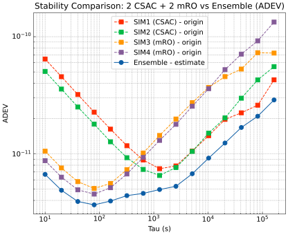

# GstarTimescale Lab · 时间尺度科研入门

**给本科生的实验入口：生成时钟数据 → 运行组合时间尺度 → 打开报告 → 比较五条 ADEV 曲线。**

这里公开教程、实验配置、数据生成和分析脚本。GSTAR 的核心求解程序由教师单独发给学生，不在这个仓库、Git 历史或 GitHub Releases 中。学生不需要接触核心 C++ 源码，也不需要安装 C++ 编译器。

默认实验是 **2 只 CSAC + 2 只 mRO、10 天、10 秒采样**；另有四只同类白相位噪声模型的基础案例。两者都是合成数据实验。当前教学入口使用 PFD 时钟比对，不需要 STK、轨道数据或 Jupyter。



*上图是固定种子的案例预览。CSAC/mRO 参数是研究预设，不代表某款物理钟的标定性能；单次结果不能证明所有情况下都能改善。*

## 第一次使用：按顺序做这六步

### 1. 下载公开实验仓库

点击本页右上方 **Code → Download ZIP**，解压到空间充足的磁盘；进入包含 `lab.py` 的文件夹。建议使用简短英文目录名。也可以使用 Git：

```powershell
git clone https://github.com/Xsleet/GstarTimescale-Lab.git
cd GstarTimescale-Lab
```

下载仓库的 ZIP 和教师发的程序 ZIP 是两个不同的文件。不要把教师的程序包上传到 GitHub。

### 2. 安装 Python，创建独立环境

需要 **Windows 10/11 x64** 和 **64 位 Python 3.11 或 3.12**。从 [Python 官方下载页](https://www.python.org/downloads/windows/)下载安装；安装时勾选添加 Python 到 PATH。依赖集合也支持 Python 3.10，但首版验证使用 3.11/3.12，暂不使用 3.13 及更新版本。

在这个文件夹打开 PowerShell，执行：

```powershell
python --version
python -m venv .venv
.\.venv\Scripts\python.exe -m pip install -r requirements-demo.txt
```

后续一直使用 `.\.venv\Scripts\python.exe`，**不需要执行 Activate.ps1**，也不需要修改 PowerShell 执行策略。独立环境可避免与已有 Anaconda、NumPy 等发生版本冲突。

### 3. 安装教师提供的核心程序包

向任课教师领取 `GstarTimescale-engine-0.1.0-windows-x64.zip`。它没有公开下载地址。将下面引号里的内容替换成你收到的 ZIP 的实际路径，**无需先解压**：

```powershell
.\.venv\Scripts\python.exe lab.py install-engine "教师发给你的程序包.zip"
```

安装器校验整个 ZIP 和内部文件的 SHA256，安装到 `engine/`。版本不匹配、文件损坏或存在额外文件时会拒绝安装。安装不会执行 ZIP 中的程序。

### 4. 检查环境

```powershell
.\.venv\Scripts\python.exe lab.py doctor
```

看到 Windows、Python packages、Runtime SHA256 三项 `PASS` 后继续。有错误先看 [故障排查](docs/troubleshooting.md)。

### 5. 跑完整的 10 天异构实验

```powershell
.\.venv\Scripts\python.exe lab.py run
```

默认参数为 `--case heterogeneous --days 10 --seed 2026 --architecture centralized`。10 天是**仿真时间**，无需等待现实中的 10 天。程序先生成数据，再求解，最后绘图。运行耗时取决于电脑；日志位于实验文件夹的 `logs/`。请预留磁盘空间，完整案例会生成数百 MB 级数据。

### 6. 打开结果

```powershell
Start-Process .\Runs\heterogeneous_10days\report.html
```

也可以在文件管理器中双击该 HTML。报告无需联网，包含：

- 四只原始钟和组合时间尺度的相位曲线；
- **五条 ADEV 曲线**，以及相同目标 τ 下的数值比较；
- 有效样本数、运行检查结果、CSV/TSV 数据和 PNG/PDF/SVG 图片链接。

从 [如何读结果](docs/results.md) 开始：先认识坐标和单位，再比较哪段平均时间上有所改善。

## 常用实验命令

每次实验使用新输出目录，已有结果不会自动覆盖。

```powershell
# 基础案例：四只同类噪声模型、不同噪声幅度的合成钟
.\.venv\Scripts\python.exe lab.py run --case basic --output Runs/basic_10days

# 换一个随机种子，仍运行 10 天
.\.venv\Scripts\python.exe lab.py run --seed 2027 --output Runs/heterogeneous_seed2027

# 只生成输入，不需要核心程序或科学计算依赖
.\.venv\Scripts\python.exe lab.py prepare --output Runs/inputs_only

# 已有结果重新生成报告，不重跑核心程序
.\.venv\Scripts\python.exe lab.py report --output Runs/heterogeneous_10days

# 查看所有选项
.\.venv\Scripts\python.exe lab.py run --help
```

`prepare` 生成的目录不能直接传给 `run`，因为 `run` 会创建全新的实验。准备后手动修改输入并运行，见 [进阶实验说明](docs/student-guide.md#修改生成后的输入)。

## 学习路线

| 你要做什么 | 看哪里 |
|---|---|
| 认识时钟、PFD、时间尺度和文件结构 | [学生指南](docs/student-guide.md) |
| 从零开展几个小课题 | [分级实验任务](docs/experiments.md) |
| 理解相位、ADEV、长 τ 样本数 | [结果说明](docs/results.md) |
| 理解 2 CSAC + 2 mRO 的具体参数 | [异构案例](examples/heterogeneous/README.md) |
| 安装失败、没有图、运行目录已存在 | [故障排查](docs/troubleshooting.md) |
| 教师发包、升级、保护私有工程 | [教师指南](docs/instructor-guide.md) |
| 查看哪些内容已经验证 | [验证范围](docs/validation.md) |

## 公开范围与适用边界

这是**公开教学仓库，不是核心算法的开源仓库**。核心程序是独立的 Windows x64 可执行文件；生成器与分析脚本可读可改，滤波、融合等求解实现在程序内部。没有私有程序包也可阅读教程、生成输入；实际求解需要教师提供程序。

首版围绕四钟、二状态、PFD 实验组织。ISL、轨道仿真、任意卫星数量和其它状态模型未封装为本仓库的一键课程。分布式架构作为进阶选项，不代表已在所有参数组合下完成验证。

`engine/`、`Runs/` 和二进制文件默认被 Git 忽略；提交钩子与 CI 检查公开文件。它们用于减少误提交，不是防拷贝或授权控制。请勿将私有程序包添加到公开仓库、Issue、Release 或 CI 附件。编译后的程序也不是不可逆的加密。

使用范围见 [LICENSE.md](LICENSE.md)，问题反馈见 [CONTRIBUTING.md](CONTRIBUTING.md)。
