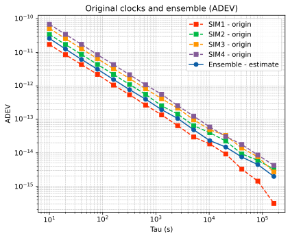
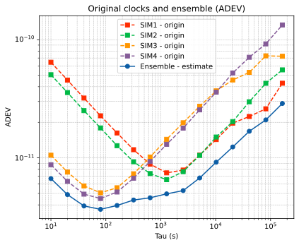

# GstarTimescale Lab · 时间尺度实验与分析

**编辑配置 → 运行 GstarTimescale.exe → 查看结果文件 → 单独运行绘图脚本。**

本仓库公开实验配置、输入准备和绘图代码。核心求解器以独立 Windows 程序提供；使用者可以直接修改配置、调用程序和分析输出，无需阅读或编译核心 C++ 源码。

建议从 **2 只 CSAC + 2 只 mRO、10 天、10 秒采样** 的 PFD 案例开始。它只使用时钟比对数据，不需要轨道或 STK。

## 先看看运行后能得到什么

下面是最初两个 **10 天、10 秒采样** 样例的实际 ADEV。每张图都包含四只原始钟和蓝色的组合时间尺度，纵轴越低通常表示相应平均时间上的稳定度越好。

| 基础四钟样例 | 2 CSAC + 2 mRO 异构样例 |
|---|---|
|  |  |
| 学会读图：组合并非总优于最好的一只钟 | 观察互补：不同类型钟在短期与较长期各有所长 |

**[查看两个样例的相位图、ADEV 图、数值对照和运行命令](docs/example-results.md)**。可以先看结果，再按下面步骤自己生成图片。

## 先认识这几个文件

| 文件 | 你用它做什么 |
|---|---|
| [config/file_table](config/file_table) | 告诉程序去哪里读取运行配置、对象配置和基础表 |
| [config/Timescale.cfg](config/Timescale.cfg) | 设置算法模式、开始时间、运行时长、采样间隔、输入与输出路径 |
| [config/session.obj](config/session.obj) | 设置参与的钟、观测类型、初始不确定度及噪声参数 |
| `engine/GstarTimescale.exe` | 读取上述配置并解算，需单独获取授权运行包 |
| [tools/plot_results.py](tools/plot_results.py) | 读取解算结果，绘制相位和 ADEV 图；脚本顶部可直接修改路径和参数 |

仓库实际使用小写文件名 `session.obj`。名字由 `file_table` 中的 `object` 一行指定；如果改名为 `Session.obj`，也要同步这一行。

## 1. 准备环境和程序，只需做一次

下载仓库并解压，在包含 `lab.py` 的文件夹中打开 PowerShell。使用 Windows x64、Python 3.11 或 3.12：

```powershell
python -m venv .venv
.\.venv\Scripts\python.exe -m pip install -r requirements-demo.txt
```

从维护者提供的渠道取得运行包，使用下面的安装命令解压并校验到 `engine/`：

```powershell
.\.venv\Scripts\python.exe lab.py install-engine "GstarTimescale-engine-0.1.0-windows-x64.zip"
```

之后求解时直接调用 `engine/GstarTimescale.exe`。安装步骤不会运行实验。

## 2. 准备一个有数据的实验目录

没有自己的 CLK/PFD 数据时，先生成一套 10 天示例输入：

```powershell
.\.venv\Scripts\python.exe tools/run_demo.py --prepare-only --clock-profile csac-mro --days 10 --output Runs/manual_case
```

**这条命令只准备数据和初始配置。执行完成后停下来，打开配置文件看一看，再运行程序。** 后面每次改算法参数时，可以复用这份输入，不必重新生成。

```text
Runs/manual_case/
  config/
    file_table       配置与基础表索引
    Timescale.cfg    时间、模式、输入输出路径
    session.obj      四只钟及其噪声假设
    svinf.dat        对象编号与输出名称映射
    leap.sec         闰秒表
    pan_info         本 PFD 案例的辅助表占位
  clk/               标准钟差输入
  pfd/               两两时钟比对输入
  results/           程序将在这里写结果
```

已有标准数据时，也可以自己创建实验目录，把本仓库 `config/` 整个复制进去，放好 CLK/PFD，再编辑其中的路径。具体方法见[配置目录说明](config/README.md)。

## 3. 直接编辑三个配置文件

本次要编辑的是 **`Runs/manual_case/config/` 中的文件**。

`file_table` 中最主要的两行是：

```text
 TimescaleCfg config/Timescale.cfg
 object config/session.obj
```

`Timescale.cfg` 中先认识这些设置：

```text
 Start time&session length   = 2026 01 01 00 00 00 864000 [GPST]
 Processing interval         = 10
 Project directory           = results
 LEO Clk full name           = clk/SIM0MGNFIN_-YEARDOY-0000_01D_10S_CLK.CLK
 PFD data directory          = pfd
 Timescale scope             = satellite
 Rank deficiency remedy      = GREENHALL
 Estimation architecture     = centralized
```

上面是从完整文件中摘出的关键字段；在原位置修改，保留原有段落标记。`864000` 秒等于 10 天，结束时刻是开始时刻加运行时长。`-YEARDOY-` 会替换为年份和年积日，例如 `2026001`。

`session.obj` 每个对象行最后的参数可以调整，例如：

```text
Phase:[初始相位标准差,相位扩散系数]
Frequency:[初始频率标准差,频率扩散系数]
Link_Noise:{Default:观测噪声标准差}
```

这些参数是求解器对钟和观测的假设，修改它们不会改写已有输入数据。完整说明见[配置指南](docs/configuration.md)。

**相对路径以程序启动时所在的实验目录为基准。** 因此，下面先进入 `Runs/manual_case` 再运行。修改时间时要保证输入覆盖该时段；初次使用保留示例的 10 天、10 秒设置。

## 4. 直接运行程序

在仓库根目录执行：

```powershell
Push-Location Runs/manual_case
& ..\..\engine\GstarTimescale.exe config/file_table
Pop-Location
```

这就是实际的求解命令：**程序路径 + file_table 路径**。程序按你刚刚编辑的文件运行。

运行结束后，打开 `Runs/manual_case/results/`：

| 结果文件 | 含义 |
|---|---|
| `IEM.txt` | 组合时间尺度；每行 `IEM` 标记后面的数字是相位，单位秒 |
| `SIM1.txt`～`SIM4.txt` | 四只钟的原始值和估计值；第 5 列为原始钟相位，单位秒 |
| `gstar.log` | 程序运行日志；出现错误或结果不完整时从这里查起 |

结果目录由 `Project directory` 决定。例如改为 `results/greenhall_test`，结果就在这个新目录。直接运行 exe 可能覆盖同名输出；比较不同设置时使用新的结果目录，保留之前的配置副本。

文件逐列说明和小例子见[结果文件与图片](docs/results.md)。

## 5. 单独运行绘图脚本

回到仓库根目录：

```powershell
.\.venv\Scripts\python.exe tools/plot_results.py
```

它默认读取 `Runs/manual_case/results/`。也可以直接编辑[脚本顶部](tools/plot_results.py)的 `RESULTS_DIR`、`CLOCK_IDS`、`SAMPLE_INTERVAL_S`，然后再运行。或者在命令中指定：

```powershell
.\.venv\Scripts\python.exe tools/plot_results.py --results Runs/manual_case/results --output Runs/manual_case --interval 10
```

这一步只读结果、计算 ADEV 和画图。可以反复修改标题、图例、坐标范围或颜色再重画，无需重新解算。

| 绘图输出 | 用途 |
|---|---|
| `figures/phase.png` | 四只原始钟与组合时间尺度的相位变化图 |
| `figures/adev.png` | **四只原始钟 + Ensemble，共五条 ADEV 曲线** |
| 同名 `.pdf`、`.svg` | 用于报告、打印或进一步排版的矢量图 |
| `analysis/phase.csv` | 实际日期、公共时间轴和五路相位原值 |
| `analysis/adev.tsv` | ADEV 曲线的数值 |
| `analysis/stability_summary.tsv` | 指定平均时间 τ 上直接计算的 ADEV、误差估计与有效项数 |

```powershell
Start-Process .\Runs\manual_case\figures\phase.png
Start-Process .\Runs\manual_case\figures\adev.png
```

ADEV 横轴是平均时间 τ，纵轴越低通常表示该 τ 上的稳定度越好。先比较彩色组合曲线与四只原始钟，再观察短期和较长期表现，详见[读图说明](docs/results.md)。

## 第一个修改练习

先按默认参数完成上述流程。在实验的 `config/` 目录中，将 `Timescale.cfg` 复制为 `Timescale_noise.cfg`，将 `session.obj` 复制为 `session_noise.obj`。然后编辑三个文件：

1. 在 `file_table` 中，把 `TimescaleCfg` 改为 `config/Timescale_noise.cfg`，把 `object` 改为 `config/session_noise.obj`。
2. 在 `Timescale_noise.cfg` 中，把 `Project directory` 改为 `results/noise_test`。
3. 在 `session_noise.obj` 中，将第一只钟的 `Link_Noise.Default` 从约 `1e-12` 改为 `2e-12`。

再次执行第 4 步的同一个 exe 命令，再画新结果：

```powershell
.\.venv\Scripts\python.exe tools/plot_results.py --results Runs/manual_case/results/noise_test --output Runs/manual_case/noise_test
```

观察相位和 ADEV 有无变化。变化可能很小，这也是实验结果。旧配置和旧结果仍保留；把 file_table 两行改回即可切回原来的设置。这个练习让三个配置文件都参与实际操作。

## 继续使用

| 需要什么 | 入口 |
|---|---|
| 先看初始两个样例的完整结果 | [样例结果与读图练习](docs/example-results.md) |
| 配置字段、起止时间、模式和路径 | [配置指南](docs/configuration.md) |
| 结果逐列解释、相位与 ADEV | [结果文件与图片](docs/results.md) |
| 概念与实验目录说明 | [用户指南](docs/user-guide.md) |
| 第 4.3 节论文数据与实验 | [论文实验教程](examples/thesis-section43/README.md) |
| 2 CSAC + 2 mRO 的输入参数 | [异构案例](examples/heterogeneous/README.md) |
| 一键演示、自动检查和 HTML 报告 | [可选便利命令](docs/convenience-commands.md) |
| 常见错误 | [故障排查](docs/troubleshooting.md) |

核心程序单独分发；公开仓库和 Releases 提供教程、配置、绘图脚本及经整理的实验数据。`engine/` 和 `Runs/` 默认不进入 Git。使用范围见 [LICENSE.md](LICENSE.md)，维护方式见[维护者指南](docs/maintainer-guide.md)。
