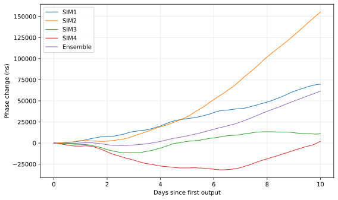
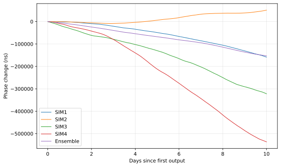

# 先看结果：4 CSAC 与异构样例

下面是两个 **10 天、10 秒采样** 样例的实际解算结果。每个样例都有相位图和 ADEV 图，均包含四只原始钟与一条组合时间尺度（Ensemble）。没有核心程序也可以先读图。

| 条件 | 4 CSAC 基础样例 | 2 CSAC + 2 mRO 异构样例 |
|---|---|---|
| 数据 | 已有仿真归档 CSAC_01～CSAC_04 | 仓库脚本按给定模型生成 |
| 时长与采样 | 10 天，10 秒 | 10 天，10 秒 |
| 解算设置 | centralized + GREENHALL | centralized + GREENHALL |
| 起点 | 2026-01-01 GPST | 相同 |
| 有效结果 | 每条曲线 86397 点 | 每条曲线 86397 点 |
| 学习重点 | 同类时钟如何组合 | 不同类型钟的短期与较长期互补 |

## 样例一：已有仿真中的四只 CSAC

按编号选取论文归档 csac_only_group01 的 CSAC_01～CSAC_04，分别对应 SIM1～SIM4。数据直接复用，没有重新生成，也没有按结果筛选。各钟属于同一类型，参数略有差别。数据与配置说明见 [CSAC 案例](../examples/csac/README.md)。

### 相位图：观察钟差随时间积累



横轴为经过的天数，纵轴为相位变化，单位纳秒。每条曲线减去自己的首值，便于观察变化；数值文件保留相位原值。曲线平不平不能单独判断稳定性，继续看 ADEV。

### ADEV 图：在同一个平均时间比较


横轴 τ 是平均时间，纵轴越低通常表示越稳定。蓝色 Ensemble 是组合时间尺度，另外四条是原始 CSAC。先对照下面表格中的 10 秒和 1000 秒，再观察整条曲线。

## 样例二：2 只 CSAC + 2 只 mRO

SIM1、SIM2 为 CSAC，SIM3、SIM4 为 mRO。本样例采用白频噪声和频率随机游走，使两类钟呈现不同的短期与较长期特性，参数见[异构案例说明](../examples/heterogeneous/README.md)。

### 相位图：观察长期累积变化



这里的相位曲线体现频率变化随时间累积。相位图同样减去了各自首值，主要用于观察变化过程；判断稳定度改善要看 ADEV。

### ADEV 图：观察短期与较长期的互补


先看左侧：SIM3/SIM4（mRO）的曲线较低，短期表现较好。再看右侧：SIM1/SIM2（CSAC）在较长期表现出优势。蓝色 Ensemble 在这次运行中综合了这些特性，所列的三个代表性 τ 上都优于当时最佳的单钟。

例如 **τ=1000 秒**：最佳单钟 SIM2 的 ADEV 约为 **6.650e-12**，组合为 **4.757e-12**，约降低 **28.5%**。这里的百分比指 ADEV 数值降低，不是绝对授时误差降低。

## 用几个数字练习读图

指定 τ 直接计算，不从图中插值。“组合/最佳单钟”小于 1，表示这一点组合更稳定。

| 样例 | τ（秒） | 最佳单钟 | 单钟 ADEV | 组合 ADEV | 组合/最佳单钟 |
|---|---:|---|---:|---:|---:|
| 4 CSAC | 10 | SIM1 | 5.113e-11 | 2.834e-11 | 0.554 |
| 4 CSAC | 1000 | SIM1 | 6.472e-12 | 3.439e-12 | 0.531 |
| 4 CSAC | 86400 | SIM1 | 2.093e-11 | 2.088e-11 | 0.998 |
| 异构 | 10 | SIM4 | 8.745e-12 | 6.677e-12 | 0.764 |
| 异构 | 1000 | SIM2 | 6.650e-12 | 4.757e-12 | 0.715 |
| 异构 | 86400 | SIM1 | 2.778e-11 | 2.324e-11 | 0.836 |

三个 τ 的有效项数分别为 86395、862、8。平均时间越长，可用于比较的项数越少。先在各样例内部比较单钟与组合；两组数据来源不同，不把两张图直接当作严格的同构/异构优劣试验。

## 自己运行并绘图

按首页安装环境和授权运行包，然后在仓库根目录执行：

```powershell
.\.venv\Scripts\python.exe tools/prepare_csac.py --output Runs/csac_10days
# 打开 config/，查看或修改 file_table、Timescale.cfg、session.obj
Push-Location Runs/csac_10days
& ..\..\engine\GstarTimescale.exe config/file_table
Pop-Location
.\.venv\Scripts\python.exe tools/plot_results.py --results Runs/csac_10days/results --output Runs/csac_10days
Start-Process .\Runs\csac_10days\figures\adev.png
```

异构样例只需把准备命令换为下面这一条，再对其目录执行相同的“exe → 绘图”步骤：

```powershell
.\.venv\Scripts\python.exe tools/run_demo.py --prepare-only --clock-profile csac-mro --days 10 --seed 2026 --output Runs/heterogeneous_10days
```

结果在各自 `results/`，图在 `figures/`，数值在 `analysis/`。目录已存在时换一个新名字。本页完整数值及结果哈希见 [example-results.json](example-results.json)。
