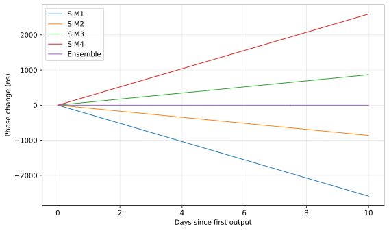
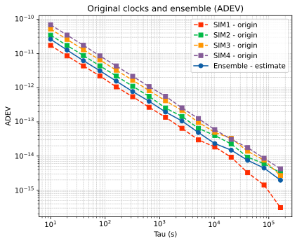
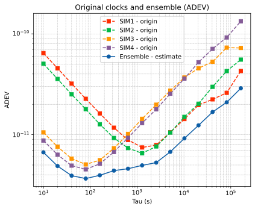

# 先看结果：两个初始样例

下面展示最初两个样例的实际解算结果。**没有核心程序也能先看图，了解运行后会得到什么。** 每个样例都有相位图和 ADEV 图，均包含四只原始钟与一条组合时间尺度（Ensemble）。

| 条件 | 基础样例 basic | 异构样例 heterogeneous |
|---|---|---|
| 时钟 | 同类白相位噪声模型，四只钟的噪声幅度不同 | 2 只 CSAC + 2 只 mRO |
| 时长与采样 | 10 天，10 秒 | 10 天，10 秒 |
| 解算设置 | centralized + GREENHALL | centralized + GREENHALL |
| 仿真起点 / 种子 | 2026-01-01 GPST / 2026 | 相同 |
| 公共有效结果 | 每条曲线 86397 点 | 每条曲线 86397 点 |
| 适合先学什么 | 文件、坐标、单钟和组合的区别 | 不同类型钟在不同平均时间上的互补 |

相位图回答“钟差随时间怎样变化”；ADEV 图回答“在某个平均时间上，哪条时间序列更稳定”。两种图一起看，更容易理解结果。

## 样例一：四只同类模型的基础钟

四只钟都有初始钟差、固定频率偏差和白相位噪声。SIM1～SIM4 的白相位噪声标准差分别为 **0.1、0.2、0.3、0.4 ns**。这是便于入门的合成模型。

### 相位图：先认识时间和单位



横轴为经过的天数，纵轴为相位变化，单位纳秒。每条曲线减去了自己的首个相位，所以都从零附近开始。四只钟的固定频率偏差不同，形成不同斜率；这组设置下组合曲线接近水平。

**接近水平不等于没有噪声，也不等于 ADEV 一定最好。** 10 天的全局相位图看不清亚纳秒级的随机波动，继续看下一张图。

### ADEV 图：组合不一定胜过最好的一只钟



横轴 τ 是平均时间，纵轴是 ADEV；在同一个 τ 上，曲线越低通常表示越稳定。蓝色圆点实线为 Ensemble，其余四条是原始钟。

这组数据的曲线大体随 τ 增大而下降。SIM1 的白相位噪声最小，在很多 τ 上优于组合；组合则优于多只噪声较大的钟。这个样例让你学会**按实际曲线比较，而不是默认“组合后一定最好”**。

## 样例二：2 只 CSAC + 2 只 mRO

SIM1、SIM2 为 CSAC，SIM3、SIM4 为 mRO。本样例采用白频噪声和频率随机游走，使两类钟呈现不同的短期与较长期特性，参数见[异构案例说明](../examples/heterogeneous/README.md)。

### 相位图：观察长期累积变化


相比基础样例，这里的相位曲线弯曲更明显，体现频率变化随时间累积。相位图同样减去了各自首值，主要用于观察变化过程；判断稳定度改善要看 ADEV。

### ADEV 图：观察短期与较长期的互补



先看左侧：SIM3/SIM4（mRO）的曲线较低，短期表现较好。再看右侧：SIM1/SIM2（CSAC）在较长期表现出优势。蓝色 Ensemble 在这次运行中综合了这些特性，所列的三个代表性 τ 上都优于当时最佳的单钟。

例如 **τ=1000 秒**：最佳单钟 SIM2 的 ADEV 约为 **6.650e-12**，组合为 **4.757e-12**，约降低 **28.5%**。这里的百分比指 ADEV 数值降低，不是绝对授时误差降低。

## 用几个数字练习读图

下面直接在指定 τ 上计算，不从曲线图插值。“组合/最佳单钟”小于 1，表示在这一点组合更稳定。

| 样例 | τ（秒） | 当时最佳单钟 | 单钟 ADEV | 组合 ADEV | 组合/最佳单钟 |
|---|---:|---|---:|---:|---:|
| 基础 | 10 | SIM1 | 1.727e-11 | 2.612e-11 | 1.512 |
| 基础 | 1000 | SIM1 | 1.688e-13 | 2.576e-13 | 1.526 |
| 基础 | 86400 | SIM1 | 2.765e-15 | 2.547e-15 | 0.921 |
| 异构 | 10 | SIM4 | 8.745e-12 | 6.677e-12 | 0.764 |
| 异构 | 1000 | SIM2 | 6.650e-12 | 4.757e-12 | 0.715 |
| 异构 | 86400 | SIM1 | 2.778e-11 | 2.324e-11 | 0.836 |

三个 τ 的有效项数分别为 86395、862、8。平均时间越长，可用于比较的项数越少。两个样例的噪声模型不同，先比较**各自内部**的原始钟与组合，就能完成本页的入门练习。

## 自己运行并画出这些图

按[首页](../README.md)准备 Python 环境及授权运行包。以下命令在仓库根目录执行；如果同名实验目录已经存在，请换一个新名字。

基础样例：

```powershell
.\.venv\Scripts\python.exe tools/run_demo.py --prepare-only --clock-profile basic --days 10 --seed 2026 --output Runs/basic_10days
# 此时可查看、修改 Runs/basic_10days/config/ 中的三个配置文件
Push-Location Runs/basic_10days
& ..\..\engine\GstarTimescale.exe config/file_table
Pop-Location
.\.venv\Scripts\python.exe tools/plot_results.py --results Runs/basic_10days/results --output Runs/basic_10days
Start-Process .\Runs\basic_10days\figures\adev.png
```

异构样例：

```powershell
.\.venv\Scripts\python.exe tools/run_demo.py --prepare-only --clock-profile csac-mro --days 10 --seed 2026 --output Runs/heterogeneous_10days
# 此时可查看、修改 Runs/heterogeneous_10days/config/ 中的三个配置文件
Push-Location Runs/heterogeneous_10days
& ..\..\engine\GstarTimescale.exe config/file_table
Pop-Location
.\.venv\Scripts\python.exe tools/plot_results.py --results Runs/heterogeneous_10days/results --output Runs/heterogeneous_10days
Start-Process .\Runs\heterogeneous_10days\figures\adev.png
```

同一个 `figures/` 目录还有 `phase.png`、PDF 和 SVG；`analysis/` 里是实际数值。原始解算文件仍在 `results/`，逐列含义见[结果文件说明](results.md)。已有完整结果时，只需运行绘图命令。

<details>
<summary>结果来源与数值记录（可选）</summary>

本页读取最初两个完整 10 天案例保存的 IEM/SIM 输出，用当前独立绘图脚本重新绘图。两组共 90 个指定 τ 的 ADEV 与此前结果表一致；没有重新调整算法或输入来改善曲线。配置、种子、结果文件校验值和完整数值记录见 [example-results.json](example-results.json)。

相位与 ADEV 的读取、计算和绘图复用 DataProcess；核心运行包为 0.1.0。这里展示的是指定仿真模型和参数下的一次结果。

</details>
