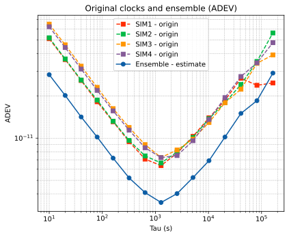

# 四只 CSAC：从已有仿真数据开始

基础案例使用已有论文仿真归档中的 **CSAC_01、CSAC_02、CSAC_03、CSAC_04**，分别输出为 SIM1～SIM4。按编号取前四只，没有重新生成随机数据，也没有按组合效果筛选。这是四只同类型的仿真钟，各钟参数略有不同。

实验时长 **10 天**，采样间隔 **10 秒**；输入覆盖 2026-01-01 至 2026-01-11（不含终点）。采用 `satellite + OBS P`、`centralized + GREENHALL`，不需要轨道或 STK。原始输入与论文第 4.3 节 `csac_only_group01` 的 CLK/PFD 完全一致。



## 1. 下载输入和配置

按[首页](../../README.md)准备 Python 环境和单独提供的核心程序。在仓库根目录执行：

```powershell
.\.venv\Scripts\python.exe tools/prepare_csac.py --output Runs/csac_10days
```

自动下载约 **14 MB** 的数据包，校验并解压到实验目录。该命令只准备数据和配置，不运行算法。数据包里没有核心源码或程序。

也可从[数据下载页](https://github.com/Xsleet/GstarTimescale-Lab/releases/tag/csac4-example-data-v1)手动下载，然后离线准备：

```powershell
.\.venv\Scripts\python.exe tools/prepare_csac.py --archive csac4-10days-inputs-v1.zip --output Runs/csac_10days
```

目录已存在时，请换一个新名字，避免覆盖自己修改过的配置。

## 2. 看配置，再直接运行

打开 `Runs/csac_10days/config/`：`file_table` 指定配置入口，`Timescale.cfg` 控制时间、模式和输入输出路径，`session.obj` 设置四只钟及其噪声参数。第一次先用默认值跑通，再一次修改一项。

```powershell
Push-Location Runs/csac_10days
& ..\..\engine\GstarTimescale.exe config/file_table
Pop-Location
```

结果在 `Runs/csac_10days/results/`：`SIM1.txt`～`SIM4.txt` 包含原始钟相位及估计状态，`IEM.txt` 最后一列为组合时间尺度相位，`gstar.log` 为运行日志。

## 3. 单独绘图

```powershell
.\.venv\Scripts\python.exe tools/plot_results.py --results Runs/csac_10days/results --output Runs/csac_10days
Start-Process .\Runs\csac_10days\figures\adev.png
Start-Process .\Runs\csac_10days\figures\phase.png
```

两张图均有 **四只原始钟 + Ensemble，共五条曲线**。相位图看钟差如何累积；ADEV 图比较相同平均时间 τ 上的稳定性，越低越好。数值保存在 `analysis/adev.tsv` 和 `analysis/stability_summary.tsv`，结果解释见[读图指南](../../docs/results.md)。

本案例固定使用已有数据，没有重新抽取随机数；改变随机种子不会产生另一组 CSAC。想探索不同随机实现，可使用另一个[2 CSAC + 2 mRO 案例](../heterogeneous/README.md)。

## 参数与来源

`config/clock_source.json` 记录四只钟的编号、种子、参数和原 CLK/PFD 哈希。保留归档的各钟过程系数；为当前运行包设置相位初始标准差 `1e-7 s`、频率初始标准差 `1e-9`、链路标准差 `1e-12 s`。这些是滤波器假设，不会改写输入钟差。历史论文配置仍在原论文数据包内。

两状态的 `session.obj` 只写 `Phase`、`Frequency` 和 `Link_Noise`，可以直接修改；不包含重复的 TotalPhase 或未使用的 WPM 字段。`[初始标准差, 过程系数]` 的具体含义见[配置指南](../../docs/configuration.md)。完整默认案例已通过 10 天严格数值检查，输出 86397 个共同历元。
