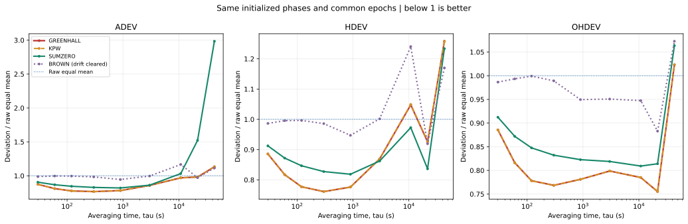
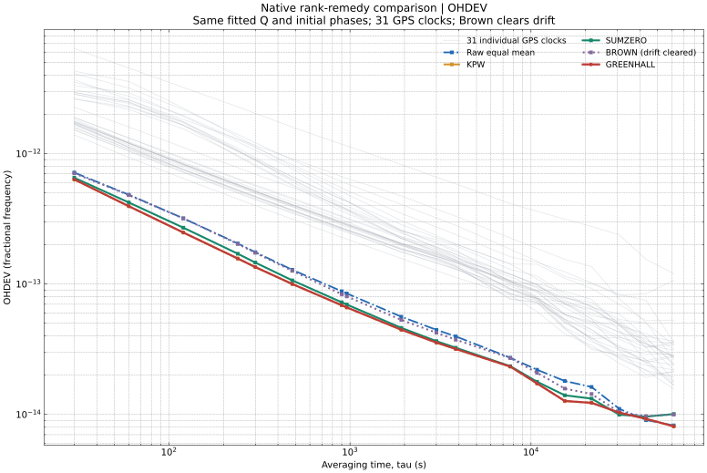

# 31 颗 GPS：正确初始化后的秩亏补偿对照

本案例使用 **2026-06-02 至 06-23、22 天、30 秒采样**的真实 GPS 钟差，比较 GREENHALL、KPW、SUMZERO、BROWN 与原始等权平均。G13 在源产品中缺失，其余 31 颗 GPS 全部参与。各方法使用相同的逐星拟合噪声参数和正确的初始相对钟差，**不使用贝叶斯优化**。

## 先看结果

下表是“组合稳定度 ÷ 同时段原始等权平均”，小于 1 表示更好。

| 方法 | OHDEV，3 小时 | OHDEV，6 小时 | OHDEV，12 小时 | ADEV，6 小时 |
|---|---:|---:|---:|---:|
| GREENHALL | 0.785046 | 0.755252 | 1.023170 | 0.981670 |
| KPW | 0.785176 | 0.755706 | 1.023427 | 0.982138 |
| SUMZERO | 0.809244 | 0.814040 | 1.063557 | 1.522170 |
| BROWN | 0.947414 | 0.882910 | 1.072794 | 0.971932 |

GREENHALL 与 KPW 的 3–6 小时重叠 HDEV 几乎重合，6 小时比等权低约 **24.5%**。12 小时时等权仍更低；这不是所有指标、所有平均时间上的统一排名。





其他曲线：[ADEV](preview/adev.svg)、[普通 HDEV](preview/hdev.svg)。四组完整结果均为原生 C++ 输出；SUMZERO 沿用已完成并与 Python 重放核对的原生结果。仓库和数据包只收录正确初始化后的结果。

## 1. 下载数据，直接核对结果

按[首页](../../README.md)安装 Python 依赖，在仓库根目录执行：

```powershell
python tools/run_gps_rank_case.py fetch --data Runs/gps_rank_data
python tools/run_gps_rank_case.py verify-reference --data Runs/gps_rank_data
Start-Process Runs/gps_rank_data/report.html
```

公开数据包约 **14.3 MB**，含原始钟差、四组组合相位、配置、统计表和 PNG/PDF 图片。这一步无需核心程序，会重新计算 36 条序列的 **1,008 个 ADEV/HDEV/OHDEV 目标值**，与已发布表格核对。

也可从 [数据 Release](https://github.com/Xsleet/GstarTimescale-Lab/releases/tag/gps-rank-initialized-data-v1)手动下载，再运行 `fetch --archive 下载的ZIP路径 --data Runs/gps_rank_data`。工具核对整个 ZIP、清单和每个文件的 SHA-256。

| 数据包中的文件 | 含义 |
|---|---|
| `data/clocks.npz` | 63,360 × 31 原始相位秒值、共同有效掩码、卫星顺序；缺失值保留 NaN |
| `data/initialized_ensembles.npz` | 四组完整 IEM 和从 3 开始的网格索引 |
| `config/<method>/` | 实际运行配置、session.obj、file_table |
| `case.json` | 逐星拟合参数、编号、时段和统计口径 |
| `reference/stability_summary.tsv` | 全部原始钟和组合的稳定度、目标 τ、差分项数 |
| `reference/validation.json` | 完整输出核对和失败方法记录 |
| `figures/`、`report.html` | 本次已验证图片和离线报告 |

## 2. 准备匹配的程序和标准输入

**重新运行此案例需要支持相对钟差初始化的新授权程序。原有 `0.1.0` 运行包不包含该功能。** 从维护者取得匹配程序后，先检查：

```powershell
python tools/run_gps_rank_case.py check-engine --exe engine/GstarTimescale.exe
python tools/run_gps_rank_case.py prepare --data Runs/gps_rank_data --output Runs/gps_rank_initialized
```

程序检查先确认初始化诊断标记，分析阶段还会核对真实初始相位，避免旧程序忽略新配置后仍被当作有效结果。程序仍通过维护者渠道单独分发；本公开案例不包含求解器或核心源码。

完整准备生成 **22 个 CLK、10,230 个双向 PFD 文件，约 1.75 GB**，逐文件验证与原实验输入完全一致。运行输出另需数 GB 空间。准备后打开 `Runs/gps_rank_initialized/config/`：每个方法都有独立配置和结果目录。

## 3. 检查初始化配置，再运行 C++

其他方法的 `Timescale.cfg` 中有：

```text
 Timescale scope = satellite
 Clock Trend state num = 3
 Estimation architecture = centralized
 Initialize relative clock phase = on
```

开关在第一次预测前设置 `x_i(0) = b_i(0) - sum_j(w_j*b_j(0))`，其中 `b_i(0)` 是首历元 CLK，`w_i` 按正相位扩散强度 `D1_i` 的 `1/sqrt(D1_i)` 归一化。它保留真实星间钟差，只确定初始共同相位参考；不修改后续定权、Q、R、初始协方差、频率或漂移均值。默认关闭，当前支持静态成员、集中式、satellite scope、三状态。

SUMZERO 的冻结配置使用等价专用键 `SUMZERO initialize relative phase = on`。五种方法实际使用的初始相位向量已逐项核对一致。

直接调用程序，四组分别写入自己的结果目录：

```powershell
foreach ($method in @('greenhall', 'kpw', 'sumzero', 'brown')) {
    Push-Location Runs/gps_rank_initialized
    & ..\..\engine\GstarTimescale.exe "config/$method/file_table"
    if ($LASTEXITCODE -ne 0) { Pop-Location; throw "运行失败：$method" }
    Pop-Location
}
python tools/run_gps_rank_case.py analyze --data Runs/gps_rank_data --output Runs/gps_rank_initialized
```

分析输出为 `analysis/stability_summary.tsv` 和 `analysis/run_validation.json`。脚本重新计算数值；页面预览图是本次已验证结果的归档，不会被新运行覆盖。原实验单组约 13–16 分钟，具体取决于硬件；跨平台浮点结果不保证逐位一致。

可选便利命令 `python tools/run_gps_rank_case.py run --exe engine/GstarTimescale.exe --output Runs/gps_rank_initialized --jobs 3` 同时管理运行、日志和退出码。默认四种方法，可用 `--methods` 选择子集。准备要求空目录，便利命令拒绝覆盖已有结果。

## 方法区别和统计边界

- **BROWN 会清零漂移状态和相应协方差**，不是严格保留漂移的三状态方法。KPW 的尺度由预测频率/漂移增量累积形成，比较包含各方法当前输出实现的差异。
- **NONE 未完成完整运行**：正确初始化后仍在 `2026-06-15 00:07:30` 触发 `asymmetric_S`，相对非对称度 `1.2521e-6` 超过 `1e-6`。保留配置和失败记录，未收录部分结果曲线。可选 `run ... --methods NONE` 复现，预期失败退出。
- 各单钟使用全量可用数据拟合 HVAR，系数冻结在 [case.json](case.json)，复现时不重新拟合或优化。模型为 `10R0/(3τ²)+D1/τ+D2τ/6+11D3τ³/120`；过程标准差填 `sqrt(D)`。D2 有 29 个零值、D3 有 24 个零值，按原 NNLS 边界结果保留。
- 初始标准差为 `[1e-8 s, 1e-11, 1e-18 /s]`；链路标准差 `sqrt(31)×5 ps`；SUMZERO 约束标准差 `1e-14`，KPW 最大权重 `0.5`。
- 长缺口主要来自 G17。任一钟缺测时不生成 PFD；CLK 的保持值只作接口占位。SUMZERO 缺口内仍更新三个伪观测，其他方法仅预测。
- 评价共 **31,826 个共同有效历元、7 个连续段**。不跨缺口取差分，不去趋势，不额外删除收敛期。ADEV/HDEV 按 τ 取差分，OHDEV 每隔 30 秒滑动，段间按差分项数合并方差。
- 重叠项相关，误差代理量不是置信区间；一天 HDEV/OHDEV 不可用，一天 ADEV 仅 2 项。噪声拟合与评价同源，属于样本内稳定度比较，不评价绝对时间准确度。

验证记录：[已验证结果](verified-results.json)、[数据清单](data-release.json)。原生实验通过 21 项核心回归、3 项缺口统计测试、10,252 个输入哈希检查、输出公式重建和图片渲染检查。科学图使用既有 DataProcess 频稳单元及保留缺口的统计适配，包含全部 31 个原始钟。
