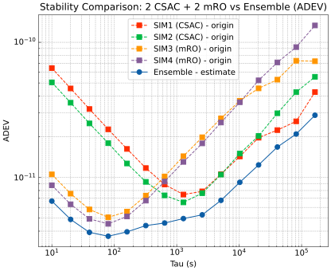

# 2 CSAC + 2 mRO · 10 天异构案例

先看[基础与异构样例的完整结果](../../docs/example-results.md)，再按其中的“准备输入 → 编辑配置 → 直接运行 exe → 单独绘图”步骤操作。默认每钟 86,400 点，10 秒采样，四钟全互连 PFD，共 10 个 CLK 文件和 60 个双向 PFD 文件。

`clocks.json` 是公开的**实验噪声参数**，并不是核心求解算法源码。SIM1/2 对应 CSAC，SIM3/4 对应 mRO。参数是研究预设，未作物理设备标定。

## 合成模型

相位为 x（秒），分数频率为 y（无量纲），采用二状态扩散模型：

```text
dx = y dt + a dW1
dy = b dW2
a = wfm_coefficient
b = sqrt(6) × rwfm_coefficient
```

W1、W2 为独立 Wiener 过程。生成器使用精确离散步进，保留频率随机游走对相位和频率增量的相关性；不是把两路独立噪声简单相加。a 的单位为 s/√s，b 的单位为 1/√s，不能直接把它们当作某个 τ 的 ADEV。

| 曲线 | 类型 | 白频系数 a | RWFM 参数（b/√6） | 默认种子 |
|---|---|---:|---:|---:|
| SIM1 / 0101 | CSAC | 2.03910e-10 | 9.52877e-14 | 2027 |
| SIM2 / 0102 | CSAC | 1.60060e-10 | 9.15558e-14 | 2028 |
| SIM3 / 0103 | mRO | 3.29966e-11 | 2.75959e-13 | 2030 |
| SIM4 / 0104 | mRO | 2.73435e-11 | 2.57526e-13 | 2031 |

本组 mRO 白频系数较小，CSAC 的频率游走系数较小，用于观察不同 τ 的互补性。生成器与滤波配置使用匹配的扩散系数；这属于理想模型已知的实验条件。

初始相位和频率偏差、初始不确定度见 JSON。PFD 是原始钟差的精确差值，没有额外注入测量噪声；`link_noise_std_s=1e-12` 是滤波器不确定度下限。模型不包含固定频率漂移、RRFM、闪烁噪声或白相位噪声。

## 应看到什么

报告包含四条原始钟与一条 Ensemble ADEV。所有曲线使用同一公共区间；精确 τ 表由 `allantools.adev(..., taus=...)` 直接计算。τ=86400 秒在当前 10 天结果中只有 8 个二阶差分项。



换种子、模型系数、初始不确定度或观测条件后，改善幅度和排序都可能变化。不要把预览图当作每次运行都必须达到的性能承诺。
