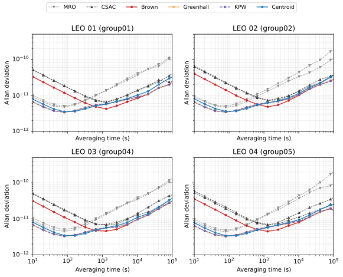

# 论文第 4.3 节入门实验：相对钟差与秩亏补偿

跟着这个案例，用论文实验数据重算图 4.7～4.11，学会三件事：**为什么需要秩亏补偿、怎样计算 ADEV、怎样比较组合时间尺度与原始时钟。** 实验为 10 天、10 秒采样，包含同构和异构钟组。

**第一次使用，先走“下载 → 分析 → 打开报告”，无需核心程序，也无需编译 C++。** 数据来自论文的仿真实验归档。学习重点是跑通计算过程、读懂曲线和得到与论文基本接近的主要结论，不要求每个数字与论文印刷值完全一致。



## 1. 先跑出第一份报告

从仓库首页点击 **Code → Download ZIP** 并解压，在包含 `lab.py` 的文件夹中打开 PowerShell。需要 Python 3.11 或 3.12；安装方法见[首页](../../README.md)。首次使用先执行：

```powershell
python -m venv .venv
.\.venv\Scripts\python.exe -m pip install -r requirements-demo.txt
```

已经创建过这个环境就跳过上面两条。接下来按顺序执行：

```powershell
# 第一步：下载并安装论文分析数据，约 102 MB
.\.venv\Scripts\python.exe tools/thesis_section43.py fetch --kind analysis --output Runs/thesis43/data

# 第二步：从相位数据重新计算 ADEV、绘图并生成报告
.\.venv\Scripts\python.exe tools/thesis_section43.py analyze --data Runs/thesis43/data --output Runs/thesis43/analysis

# 第三步：在浏览器中打开本地报告
Start-Process .\Runs\thesis43\analysis\report.html
```

看到报告中的曲线和数值表，就可以开始下面的阅读练习。数据只需下载一次；再次分析时，把输出目录换成 `Runs/thesis43/analysis_v2`，避免覆盖上一次结果。建议在空间充足的磁盘上预留 4 GB。

Linux/macOS 可以完成相同的数据分析，只需把 `.\.venv\Scripts\python.exe` 换成 `.venv/bin/python`。

<details>
<summary>自动下载失败怎么办？</summary>

从[数据下载页](https://github.com/Xsleet/GstarTimescale-Lab/releases/tag/thesis-section43-data-v1)手动下载 `thesis-section43-analysis-v1.zip`，放到仓库目录，执行下面这条命令，再接着运行上面的第二步：

```powershell
.\.venv\Scripts\python.exe tools/thesis_section43.py fetch --kind analysis --archive "thesis-section43-analysis-v1.zip" --output Runs/thesis43/data
```

`--data` 指的是安装后的数据文件夹，不是 ZIP 文件。工具会自动校验文件是否完整。

</details>

## 2. 这一节到底在算什么？

假设有四只钟，我们能测到两只钟之间的时间差，例如“钟 1 − 钟 2”。如果给所有钟同时加上同一个偏移，这些差值不会变化。因此，**只靠相对钟差，不能唯一确定所有钟共同的时间基准**；这就是本节“秩亏”问题的直观含义。

秩亏补偿为这个共同基准补充约束，或者处理相应的协方差方向，使估计能够进行。这里比较四种方法，不需要先读懂核心源码：

| 图中的名称 | 配置中的名称 | 在实验中的用途 |
|---|---|---|
| Centroid | `SUMZERO` | 显式约束方法，作为一种基准选择 |
| Brown | `BROWN` | 隐式协方差处理方法之一 |
| Greenhall | `GREENHALL` | 隐式协方差处理方法之一；重新解算的入门示例使用它 |
| KPW | `KPW` | 隐式协方差处理方法之一 |
| 无补偿 | `NONE` | 用来观察不处理秩亏时的现象 |

完整计算过程是：

```text
四只钟的仿真钟差 → 两两相减得到 PFD 观测 → GSTAR 估计与秩亏补偿
                                               ↓
                                      组合时间尺度的相位
                                               ↓
                                  计算 ADEV → 与四只原始钟比较
```

刚才的 `analyze` 从已经保存好的相位和协方差开始，重算图表。想自己执行前面的 GSTAR 解算，可继续看第 5 步。本节只使用一颗卫星内部的四只钟及其比对数据，**不需要轨道、STK 或星间链路数据**。

## 3. 怎么看图、应该得到什么结论？

先记住 ADEV 图的两个坐标：**横轴 τ 是平均时间，纵轴是频率稳定度指标 ADEV；在同一个 τ 上，越低通常表示越稳定。** 曲线左侧看短期表现，右侧看较长期表现。ADEV 衡量稳定性，不直接表示相对 UTC 的绝对误差。

每个 ADEV 子图都有 **4 只原始钟 + 4 种方法，共 8 条曲线**。灰色虚线是原始钟，彩色曲线是组合时间尺度；同类钟或不同方法曲线接近时会重叠。

| 看哪张图 | 看什么 | 这组数据体现的主要现象 |
|---|---|---|
| [图 4.7](preview/fig4_7.svg) | 无补偿时的后验标准差 | 只用相对观测而不处理秩亏，会出现估计不稳定、标准差增大的现象 |
| [图 4.8](preview/fig4_8.svg) | 补偿后的标准差变化 | 对照无补偿结果，观察约束或协方差处理怎样影响估计；这不是 ADEV 图 |
| [图 4.9](preview/fig4_9.svg) | 4 只 CSAC 的同构组合 | 多钟组合整体改善稳定性，几种补偿方法的 ADEV 很接近 |
| [图 4.10](preview/fig4_10.svg) | 4 只 mRO 的同构组合 | 同样关注组合曲线相对单钟的改善，以及方法间的接近程度 |
| [图 4.11](preview/fig4_11.svg) | 2 只 mRO + 2 只 CSAC 的异构组合 | 不同类型钟的短期和较长期特性可以互补；方法选择的影响更明显，Greenhall/KPW 整体较均衡 |

先在图 4.11 选一个子图，分别看 τ 接近 10 秒、1000 秒和 100000 秒的位置：哪类钟更低？哪条组合曲线更低？再对照图 4.9、4.10，理解为什么异构组更能体现方法差别。无需寻找“所有 τ 都最优”的单一方法。

## 4. ADEV 怎么计算，结果在哪里？

相位数据保存在 `Runs/thesis43/data/phase/`。例如 `mixed_2plus2_group01.csv` 的含义是“异构配置，第 1 组实验”：

| 列名 | 含义 |
|---|---|
| `time_s` | 相对实验起点的时间，单位秒 |
| `clock1_s`～`clock4_s` | 四只原始钟的相位，单位秒；这个异构文件中前两只为 mRO，后两只为 CSAC |
| `SUMZERO`、`BROWN`、`GREENHALL`、`KPW` | 四种方法得到的组合时间尺度相位，单位秒 |

计算 ADEV 时，工具读取一列相位，按 **10 秒采样，也就是 0.1 Hz** 调用 `allantools.adev`。它比较相邻平均时段的频率变化，用变化的大小衡量稳定性。下面就是可独立运行的最小例子；保存为仓库目录下的 `try_adev.py`，用 `.\.venv\Scripts\python.exe try_adev.py` 执行：

```python
from pathlib import Path

import allantools
import pandas as pd

path = Path("Runs/thesis43/data/phase/mixed_2plus2_group01.csv")
data = pd.read_csv(path)
for name in ["clock1_s", "GREENHALL"]:
    tau, sigma, error, count = allantools.adev(
        data[name].to_numpy(),
        rate=0.1,
        data_type="phase",
        taus=[10, 100, 1000, 10000, 100000],
    )
    print(name)
    for t, value in zip(tau, sigma):
        print(f"  τ = {t:g} s, ADEV = {value:.3e}")
```

把 `clock1_s` 改为 `clock3_s`，就能比较另一种钟；把 `GREENHALL` 改为 `BROWN`，就能比较另一种方法。`analyze` 已经替你对所有实验组完成这些计算并画图，不需要手动重复。

| 最常用的输出 | 用途 |
|---|---|
| `analysis/report.html` | 从这里开始读结果，可离线打开 |
| `analysis/figures/fig4_9.svg`～`fig4_11.svg`，以及同名 PNG | 用于查看、插入报告的 ADEV 图 |
| `analysis/tables/adev_octave.csv` | 所有组和方法的曲线数值；可按 `group`、`series` 筛选 |
| `analysis/tables/adev_exact_by_group.csv` | 异构组在指定 τ 上的 ADEV |
| `analysis/tables/table4_2_recomputed.csv` | 异构 5 组的平均 ADEV，便于比较四种方法 |

这里的平均值是**先分别计算每组 ADEV，再对 5 组结果取算术平均**。报告中的重算数值与论文表 4.2 基本接近，最大相对差异约 2.9%；入门练习重点是理解相同的计算流程与主要趋势。

## 5. 可选：自己运行一次核心解算

想从 CLK/PFD 观测开始运行，需要先按[首页](../../README.md)安装单独提供的授权运行包，并通过 `lab.py doctor`。核心运行包支持 Windows x64；公开数据下载不包含程序。

第一遍使用已经跑通的 **异构第 1 组 + Greenhall**，保持 10 天、10 秒采样：

```powershell
.\.venv\Scripts\python.exe tools/thesis_section43.py fetch --kind inputs --output Runs/thesis43/inputs
.\.venv\Scripts\python.exe tools/thesis_section43.py prepare-case --inputs Runs/thesis43/inputs --group mixed_2plus2_group01 --method GREENHALL --output Runs/thesis43/rerun
.\.venv\Scripts\python.exe lab.py inspect --workdir Runs/thesis43/rerun
.\.venv\Scripts\python.exe lab.py execute --workdir Runs/thesis43/rerun
.\.venv\Scripts\python.exe tools/thesis_section43.py compare-rerun --data Runs/thesis43/data --workdir Runs/thesis43/rerun --group mixed_2plus2_group01 --method GREENHALL --output Runs/thesis43/rerun_comparison
Start-Process .\Runs\thesis43\rerun_comparison\report.html
```

这个报告展示 **4 只原始钟 + 历史时间尺度 + 本次时间尺度，共 6 条 ADEV 曲线**。已验证的入门算例中，新旧时间尺度 ADEV 的最大相对差异约 0.014%，曲线基本重合。解算结果在 `rerun/results/`，运行日志在 `rerun/logs/`。

### 我能修改哪些配置？

可以直接编辑 `rerun/config/` 中的文件：

| 想调整什么 | 查看哪里 |
|---|---|
| 算法运行模式、时间范围、采样间隔、数据与结果路径 | `Timescale.cfg` |
| 成员钟、观测类型和噪声参数 | `session.obj` |
| 运行配置及基础表的入口 | `file_table` |

字段说明和示例见[配置指南](../../docs/configuration.md)。先用默认值跑通，再一次只改一项。所选时间段应在输入数据范围内，采样间隔应与数据一致；修改后先运行 `inspect` 查看解析结果，再运行 `execute`。每次实验使用新目录，便于对比。

同构配置名是 `csac_only`、`mro_only`，异构配置名是 `mixed_2plus2`，各有 `group01`～`group05`。切换方法和组属于进一步探索；当前程序对其他组合的运行记录见下面的进阶说明。若命令提示解算错误，先查看日志和[故障排查](../../docs/troubleshooting.md)，再继续分析。

## 进阶：数据来源与复现细节

入门流程到这里已经完成。需要研究分组映射、绘图口径、论文表格逐项差异或当前程序的验证范围时，再阅读[进阶说明](validation.md)。这些细节保留用于追溯，不作为首次使用的前置要求。

- 数据对应毕业论文第 4.3 节，覆盖图 4.7～4.11、表 4.1～4.2；仿真时段为 2026-01-01 至 2026-01-11，结束点不包含在内。
- 共 3 种配置、每种 5 组。每组四只钟；完整相位的公共区间有 86397 点，采样间隔 10 秒。
- [分组映射](reference/group_mapping.csv) · [数据下载与校验信息](data-release.json) · [论文表格参考值](paper-values.json)。
- `analyze` 沿用原论文 notebook 的非重叠相位 ADEV 计算方法；指定 τ 的数值直接计算，不从图中插值。
- 核心算法、归档数据和独立运行包保持不变。
