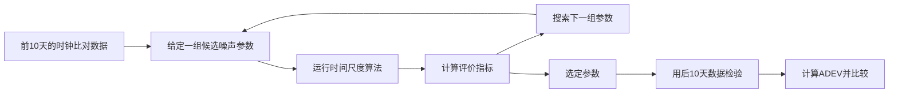

# 论文第 4.4 节入门实验：噪声参数与异构钟组的稳定性

这一节接着[第 4.3 节](../thesis-section43/README.md)：秩亏补偿方法选定后，**同样四只钟，为什么换一组噪声参数，组合时间尺度的 ADEV 就会变化？**

这里提供论文绘图归档中的数据、参数配置和绘图脚本。实验包含 **2 只 mRO + 2 只 CSAC，20 天，10 秒采样**；前 10 天用于训练及前期分析，后 10 天用于对比。第一次可以直接重画图表，不需要核心程序；之后再改 `session.obj`，亲自运行两组参数。


这份数据中，后 10 天的四组平均 ADEV 在 **τ=1000 秒**处从约 **5.94×10⁻¹² 降至 4.90×10⁻¹²，降低约 17.5%**。部分短期尺度则变差，正好可以用来理解参数调整的取舍。

**数据版本说明：**论文图 4.16、4.17 实际使用的归档结果是 `GREENHALL` 与 `GREENHALL_FREQFIX` 的比较。因此本教程如实称为“原参数 / 调整参数”，图 4.15 的搜索历史另行展示。它们支持学习参数对结果的影响，但不是从 NIS/GP-EI 搜索到验证的完整复现。具体对应关系见[数据来源与验证](validation.md)。

## 1. 先下载数据，重画图表

在包含 `lab.py` 的仓库文件夹打开 PowerShell。Python 环境只需准备一次；已有环境可跳过前两行：

```powershell
python -m venv .venv
.\.venv\Scripts\python.exe -m pip install -r requirements-demo.txt

.\.venv\Scripts\python.exe tools/thesis_section44.py fetch --kind analysis --output Runs/thesis44/data
.\.venv\Scripts\python.exe tools/thesis_section44.py analyze --data Runs/thesis44/data --output Runs/thesis44/analysis
Start-Process .\Runs\thesis44\analysis\report.html
```

工具会检查下载完整性，从相位重新计算 ADEV，再生成图、数值表和离线 HTML 报告。再次分析时换一个输出目录，例如 `Runs/thesis44/analysis_v2`。数据只下载一次。建议在空间充足的磁盘上操作，连同两次解算预留 4 GB。

分析包约 **71 MB**，解压约 **225 MB**；后面的输入包约 **116 MB**，解压约 **850 MB**。

Linux/macOS 可做同样的分析，将 Python 路径换为 `.venv/bin/python`。核心程序的运行需要 Windows x64 和单独提供的授权运行包，安装方法见[首页](../../README.md)。

自动下载不成功时，从[数据发布页](https://github.com/Xsleet/GstarTimescale-Lab/releases/tag/thesis-section44-data-v1)下载 `thesis-section44-analysis-v1.zip`，执行：

```powershell
.\.venv\Scripts\python.exe tools/thesis_section44.py fetch --kind analysis --archive thesis-section44-analysis-v1.zip --output Runs/thesis44/data
```

然后继续运行 `analyze`。`--data` 指安装后的文件夹，不是 ZIP 文件。

## 2. 这部分究竟在算什么？

可以把噪声参数理解为程序对每只钟的“稳定性预期”。滤波器根据这些参数构造过程噪声矩阵 Q，进而影响各只钟对组合结果的贡献。mRO 与 CSAC 在不同平均时间上各有优势；参数换了，它们的组合效果也会变。

第 4.4 节提出的标定思路可概括为：



这是图 4.14 所解释的方法流程。本仓库现阶段提供**归档搜索记录的重画**和**两组已保存参数的重新解算**，没有把 `prepare-case` 包装成重新进行贝叶斯搜索的命令。

| 对应图表 | 本教程做什么 | 看懂什么 |
|---|---|---|
| 图 4.12、表 4.3 | 16 只 CSAC、16 只 mRO 的平均 ADEV、模型曲线及系数表 | 两类钟的短期和长期噪声特性不同 |
| 图 4.13 | 4 CSAC、4 mRO、2+2 三种配置的改善率 | 异构钟组在优势钟型切换区域的表现 |
| 图 4.14 | 上面的流程图 | 参数搜索与独立验证怎样衔接 |
| 图 4.15 | 归档试验值、滚动中位数、四分位区间、历史最佳值 | 搜索不是每一步都变好；看历史最佳值 |
| 表 4.4 相关记录 | 导出数据库实际最佳参数及其平方 | 如何从试验记录找最优参数；不冒充论文印刷表的逐项复刻 |
| 图 4.16 | 每个面板 4 只原始钟 + 2 组参数结果，共 6 条 ADEV | 同一 τ 上组合稳定性有无改善 |
| 图 4.17 | 组合相对同类型原始钟平均 ADEV 的改善率 | 改善发生在哪个时间尺度，有没有代价 |

## 3. 自己修改参数并运行

先安装授权运行包，再准备数据与两个独立实验目录。输入包包含 1 月 1～20 日的数据；默认配置运行 **2026-01-11 00:00:00 至 2026-01-21 00:00:00 之前，GPST，10 秒间隔**。

```powershell
.\.venv\Scripts\python.exe tools/thesis_section44.py fetch --kind inputs --output Runs/thesis44/inputs

.\.venv\Scripts\python.exe tools/thesis_section44.py prepare-case --inputs Runs/thesis44/inputs --variant baseline --output Runs/thesis44/baseline
.\.venv\Scripts\python.exe tools/thesis_section44.py prepare-case --inputs Runs/thesis44/inputs --variant adjusted --output Runs/thesis44/adjusted
```

打开两个目录的 `config/`，主要看这三个文件：

| 文件 | 可以改什么 |
|---|---|
| `file_table` | `Timescale.cfg`、`session.obj` 和基础表的位置 |
| `Timescale.cfg` | 起始时间、运行秒数、采样间隔、输入输出路径、状态数、秩亏补偿方法 |
| `session.obj` | 四只钟的初始不确定度、过程噪声、链路噪声 |

`baseline`、`adjusted` 是两组**噪声参数**，两者默认都使用 `GREENHALL`。它们不是两种新的秩亏补偿方法。五种补偿方法仍可直接在 `Timescale.cfg` 的 `Rank deficiency remedy` 中填写：

```text
NONE / SUMZERO / BROWN / GREENHALL / KPW
```

也可准备时加 `--method BROWN`。切换补偿方法属于你自己的新对比实验，本节已验证的论文参数对比使用 Greenhall。

为适配当前运行包，默认配置统一使用相位初始标准差 `1e-7`、频率初始标准差 `1e-9`、链路标准差 `1e-12`；两组用相同设置，保留各自的过程噪声系数。旧值仍保存在输入包中，准备时加 `--initialization archived` 可取出，但它们在当前程序严格检查下会在首历元失败。首次按默认配置即可，详见[验证说明](validation.md)。

### `session.obj` 怎么读、怎么改？

每行代表一只钟。默认 `0101/0102` 是两只 mRO，`0103/0104` 是两只 CSAC。结果中对应 `SIM1`～`SIM4`。

```text
Phase:[初始相位标准差,相位过程噪声系数]
Frequency:[初始频率标准差,频率过程噪声系数]
Link_Noise:{Default:链路观测噪声标准差}
```

**先只改逗号后面的数。** 比如把一只钟 `Frequency` 中的第二个数乘 2，保持其余条件不变，再运行，观察 ADEV 中间区域怎样变化。这里填写的是系数的标准差形式；比较扩散系数 q 时要平方，所以填入的数乘 2，对应的平方量乘 4。不要把表里的平方量直接填进去。

更稳妥的第一次练习是保持默认配置，先完成下面的运行。以后准备一个新的输出目录再修改，避免把两次结果混在一起。数据覆盖 20 天，修改时间时保持在输入覆盖范围内；首次保持 10 秒采样和二状态、无谐波模型。[完整配置说明](../../docs/configuration.md)解释其他选项。

### 运行程序

在仓库根目录执行以下命令；每次等待程序结束再继续：

```powershell
Push-Location Runs/thesis44/baseline
& ..\..\..\engine\GstarTimescale.exe config/file_table
Pop-Location

Push-Location Runs/thesis44/adjusted
& ..\..\..\engine\GstarTimescale.exe config/file_table
Pop-Location
```

每次运行的 `results/` 中都会出现 `IEM.txt`、`SIM1.txt`～`SIM4.txt` 和 `gstar.log`。`IEM.txt` 最后一列是组合时间尺度相位（秒）；`SIM*.txt` 第 5 列是原始钟相位（秒）。不要把 IEM 内部的“钟减组合值”当作原始钟。[输出列说明](../../docs/results.md)可随时查阅。

## 4. 单独绘图，比较两次结果

先画其中一次，得到四只原始钟加组合时间尺度的 **5 条 ADEV**，以及相位图：

```powershell
.\.venv\Scripts\python.exe tools/plot_results.py --results Runs/thesis44/adjusted/results --output Runs/thesis44/adjusted --interval 10 --trend-state 2 --harmonics 0
Start-Process .\Runs\thesis44\adjusted\figures\adev.png
```

再把两次运行放在同一张图上，得到 **4 只原始钟 + 原参数组合 + 调整参数组合，共 6 条曲线**：

```powershell
.\.venv\Scripts\python.exe tools/thesis_section44.py compare-runs --baseline Runs/thesis44/baseline/results --adjusted Runs/thesis44/adjusted/results --output Runs/thesis44/comparison
Start-Process .\Runs\thesis44\comparison\comparison.png
```

比较工具会检查两次运行的实际历元和原始钟一致，避免拿不同数据做参数对比。它按本节的二状态、10 秒采样读取。若改了状态模型或采样，先用可指定这些参数的 `plot_results.py` 分别分析。

## 5. 怎么看结果，数值在哪里？

先看图 4.16 的 τ=10 秒、1000 秒、10000 秒附近：哪类原始钟更低？调整后组合在哪个区域更低？再看图 4.17 的改善率：

```text
改善率 = (1 - 组合时间尺度的平均 ADEV / 同类型原始钟的平均 ADEV) × 100%
```

先对每条相位序列计算 ADEV，再取这些 ADEV 的算术平均，最后计算比值。不要先平均相位，也不要先算每只钟的改善率再平均。正值表示改善，负值表示组合不如这一类原始钟；脚本保留负值。

| 输出 | 用途 |
|---|---|
| `Runs/thesis44/analysis/report.html` | 从这里开始读归档重算结果 |
| `analysis/figures/fig4_12.svg`～`fig4_17.svg`（不含示意图 4.14） | 可放大曲线；同时提供 PNG、PDF |
| `analysis/tables/adev_exact.csv` | 指定 τ 的 ADEV、误差估计和差分项数 |
| `analysis/tables/parameter_comparison.csv` | 后 10 天四组组合 ADEV 的平均值，以及调整后降低百分比 |
| `analysis/tables/improvement.csv` | 图 4.13、4.17 的每个点 |
| `analysis/tables/search_best_parameters.csv` | 真实归档最佳试验编号、参数及其平方 |
| `Runs/thesis44/comparison/adev_exact.tsv` | 你自己运行的六条曲线在指定 τ 的数值 |

相位数据在 `data/train/` 和 `data/evaluation/`。`time_s` 是各自 10 天窗口开始后的秒数，`clock1_s`～`clock4_s` 是原始钟相位；`baseline`、`adjusted` 是两种配置的组合相位，单位都是秒。解算初始化后从第 30 秒开始，共 86397 个连续点。`search/` 保存试验记录，试验编号从 0 开始。

理解本节的主要结论即可：**参数会影响异构钟组在噪声转换区域的组合效果；改参数后要用相同数据、相同 τ 比较，并留出独立验证时段。** 不要求复刻论文的字体或每个印刷数值，也不意味着调整后必须在所有 τ 上更好。
