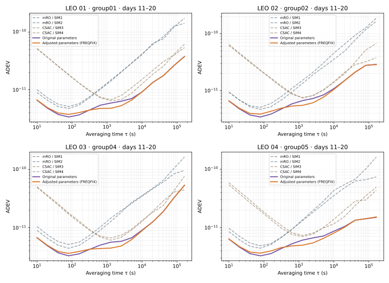

# 论文第 4.4 节实验：亲自调整与优化扩散系数

这一节要亲手完成：**改扩散系数 → 运行 GSTAR → 看 ADEV → 自动搜索参数 → 用另一段数据验证。** 核心求解器保持封装，但每一次输入参数、运行结果和评价值都可以查看。

实验使用 **2 只 mRO + 2 只 CSAC，20 天，10 秒采样**。前 10 天用于调参和搜索，后 10 天用于独立验证。先从同一组原始数据出发，不需要生成新时钟，也不需要轨道或 STK。



这张图用来认识结果的形式。下面的优化会真正运行程序产生新结果，不会读取这张图或预先保存的最优参数来代替搜索。

## 1. 准备数据与实验目录

在包含 `lab.py` 的仓库目录打开 PowerShell，按[首页](../../README.md)安装单独提供的授权运行包。首次创建 Python 环境；已有环境也请执行安装依赖这一行，以安装新增的优化依赖：

```powershell
python -m venv .venv
.\.venv\Scripts\python.exe -m pip install -r requirements-demo.txt

.\.venv\Scripts\python.exe tools/thesis_section44.py fetch --kind inputs --output Runs/thesis44/inputs
.\.venv\Scripts\python.exe tools/thesis_section44.py prepare-case --inputs Runs/thesis44/inputs --variant baseline --window train --output Runs/thesis44/train
```

已有 `inputs` 就不用重复下载。输入包约 116 MB，包含 5 个异构组的 20 天 CLK/PFD；默认选择第 1 组。训练目录 `Runs/thesis44/train/config/` 有三个主要文件：

| 文件 | 可以直接修改的内容 |
|---|---|
| `file_table` | 运行配置、对象配置和基础表的路径 |
| `Timescale.cfg` | 起始时间、时长、采样间隔、输入输出路径、秩亏补偿方法 |
| `session.obj` | 每只钟的初始不确定度和过程噪声参数 |

默认训练期是 **2026-01-01 00:00:00 至 2026-01-11 00:00:00 之前，GPST**；时长 864000 秒，采样间隔 10 秒。默认二状态、无谐波、Greenhall。

秩亏补偿仍可以在 `Timescale.cfg` 的 `Rank deficiency remedy` 中填写 `NONE / SUMZERO / BROWN / GREENHALL / KPW`。本节先固定 Greenhall，专门观察扩散系数的作用；也可以准备时加 `--method BROWN` 开展另一组实验。

## 2. 先手动改一次扩散系数

程序用噪声参数构造过程噪声矩阵 Q，从而影响各只钟对组合结果的贡献。`session.obj` 中每行对应一只钟：

| 编号 | 类型 | 输出文件 |
|---|---|---|
| `0101`、`0102` | 两只 mRO | `SIM1.txt`、`SIM2.txt` |
| `0103`、`0104` | 两只 CSAC | `SIM3.txt`、`SIM4.txt` |

每行末尾可以看到：

```text
Phase:[初始相位标准差,相位过程噪声系数]
Frequency:[初始频率标准差,频率过程噪声系数]
```

这里的过程噪声系数使用标准差形式；本教程以 q₁、q₂ 表示它们的平方：

```text
q₁ = Phase 第二个数的平方       → 填入 Phase 的数 = √q₁
q₂ = Frequency 第二个数的平方   → 填入 Frequency 的数 = √q₂
```

例如第 1 只 mRO 的原始 `Frequency` 第二个数是 `2.897e-13`，对应 q₂≈`8.392609e-26`。如果想把 q₂ 增大 4 倍，就把这个数改成 **`5.794e-13`**。先只改这一只钟的一个参数，**逗号前的初始标准差保持不变**，这样容易判断变化来自哪里。

建议先按原配置运行一次：

```powershell
Push-Location Runs/thesis44/train
& ..\..\..\engine\GstarTimescale.exe config/file_table
Pop-Location
.\.venv\Scripts\python.exe tools/plot_results.py --results Runs/thesis44/train/results --output Runs/thesis44/train
Start-Process .\Runs\thesis44\train\figures\adev.png
```

然后准备一个新的训练目录，**打开它的 `session.obj` 手动修改**，再运行：

```powershell
.\.venv\Scripts\python.exe tools/thesis_section44.py prepare-case --inputs Runs/thesis44/inputs --variant baseline --window train --output Runs/thesis44/manual
# 现在编辑 Runs/thesis44/manual/config/session.obj，再执行下面几行。
Push-Location Runs/thesis44/manual
& ..\..\..\engine\GstarTimescale.exe config/file_table
Pop-Location
.\.venv\Scripts\python.exe tools/thesis_section44.py compare-runs --baseline Runs/thesis44/train/results --adjusted Runs/thesis44/manual/results --output Runs/thesis44/manual_comparison
Start-Process .\Runs\thesis44\manual_comparison\comparison.png
```

比较图包含 **四只原始钟 + 修改前组合 + 修改后组合，共六条 ADEV**。先看 τ=100、1000、10000 秒附近有什么变化。改大参数不一定更好，某一段改善也不保证所有时间尺度都改善。

## 3. 让程序真正搜索扩散系数

手动试一次以后，让优化脚本重复这件事。先从你当前的训练配置生成一份可编辑搜索配置：

```powershell
.\.venv\Scripts\python.exe tools/optimize_diffusion.py init --case Runs/thesis44/train --output Runs/thesis44/search.json
notepad Runs/thesis44/search.json
```

这一步只读取 `Timescale.cfg`、`session.obj`，写出搜索设置，**不会拟合或优化任何参数**。

在 `search.json` 中可以改：

| 字段 | 含义与练习建议 |
|---|---|
| `trials` | 总试验次数，默认 12，包含第 0 次原参数运行；想更充分搜索可改为 30 或 50 |
| `startup_trials` | 初始探索次数，默认 4；后续使用 TPE 贝叶斯优化选择候选值，必须小于总次数 |
| `seed` | 随机种子，默认 42，便于按相同顺序重复实验 |
| `objective_taus_s` | 评价哪些平均时间，默认 `[300, 1000, 3000]` 秒，关注中期表现 |
| `parameters` 中的 `0101`～`0104` | 分别控制四只钟 |
| 每只钟的 `q1/q2 → enabled` | `true` 表示参与搜索，`false` 表示固定在训练 `session.obj` 当前值 |
| `q1/q2 → min/max` | 扩散系数的搜索下限、上限；**这里直接填 q，不需要开平方** |

初始范围围绕你自己的配置生成，默认 q₁ 为当前值的 0.25～4 倍，q₂ 为 0.1～100 倍。**推荐第一次把 q₁ 的 `enabled` 都改成 `false`，只优化 q₂**；学会读结果后再同时优化 q₁、q₂。也可以只启用一只钟的 q₂，观察一维搜索。

接着启动实际搜索：

```powershell
.\.venv\Scripts\python.exe tools/optimize_diffusion.py run --config Runs/thesis44/search.json --output Runs/thesis44/search
```

每轮都会执行以下步骤，终端会显示 `Trial 1/12` 等进度：

1. 选择一组 q₁、q₂，换成 √q 写入该轮的 `session.obj`。
2. 调用私有的 `GstarTimescale.exe`，完整运行前 10 天。
3. 检查日志、数值和输出历元，用实际组合相位计算指定 τ 的 ADEV。
4. 计算评价值，保存本轮结果，再选择下一组参数。

本入门实验的评价值为 **选定 τ 上 `log10(ADEV)` 的平均值，越小越好**。它直接来自本轮程序输出。这里使用仿真数据的组合相位评价稳定性；不能把这个评分原样当成无真值在轨观测的评价指标。

优化由公开的 Python 脚本和 Optuna TPE 驱动，核心滤波求解仍在封装程序中。想研究搜索策略，可直接阅读或修改 [optimize_diffusion.py](../../tools/optimize_diffusion.py) 的 `score_phase`、搜索范围与采样器设置。TPE 的参数说明见 [Optuna 官方文档](https://optuna.readthedocs.io/en/v4.5.0/reference/samplers/generated/optuna.samplers.TPESampler.html)。

一次 10 天解算在验证机器上约需 2～3 分钟，12 次搜索可能需要半小时左右，机器不同会有差异。不会为了加快演示偷偷缩短到一天。每轮结果都保留，建议预留 5 GB；增加次数时相应增加空间。先做最小流程练习时可设 `trials=4`、`startup_trials=2`，但几次试验不能说明已收敛。

## 4. 查看每一轮发生了什么

```text
Runs/thesis44/search/
  search.json                 本次搜索设置的快照
  initial_parameters.json     实际起始 q₁/q₂
  trials.csv                  每轮阶段、参数、评分、历史最佳值与失败原因
  trials/trial_000/
    config/session.obj        第 0 轮真正交给程序的参数
    results/IEM.txt           第 0 轮实际组合结果
    results/SIM1.txt ...      原始钟与估计结果
    logs/                     运行日志和严格检查记录
    parameters.json           该轮的 q₁/q₂
    score.json                实际 ADEV、误差估计和评价值
  trials/trial_001/ ...        其他轮次，结构相同
  best_parameters.json        本次搜索选中的 q₁/q₂
  best_case/config/           选中参数对应的原生训练配置
  summary.json               最佳试验编号及训练区间
  figures/convergence.png     实际收敛曲线
  report.html                 搜索过程报告
```

```powershell
Start-Process .\Runs\thesis44\search\report.html
```

每个散点都是一次真实解算，黑线是截至当时的最好评价值。候选值可以变差，失败试验也会保留。第 0 次就是你的起始配置；如果最终仍选中第 0 次，表示**这次预算和范围内没有找到更好参数**，不会把预设结果填进去。

想单独重画搜索过程，而不重新搜索：

```powershell
.\.venv\Scripts\python.exe tools/optimize_diffusion.py plot --search Runs/thesis44/search
```

## 5. 把搜索出的参数放到后 10 天验证

先准备后 10 天的原参数目录，再把**本次实际选中的参数**写入另一个目录：

```powershell
.\.venv\Scripts\python.exe tools/thesis_section44.py prepare-case --inputs Runs/thesis44/inputs --variant baseline --window evaluation --output Runs/thesis44/test_initial
.\.venv\Scripts\python.exe tools/optimize_diffusion.py apply --search Runs/thesis44/search --case Runs/thesis44/test_initial --output Runs/thesis44/test_best
```

打开 `test_best/config/session.obj` 检查参数，和 `best_parameters.json` 对照：填入的数平方后应等于对应 q。`apply` 只准备配置，不运行程序；它会检查验证时间在训练之后，并保持相同钟组与补偿方法。

然后直接调用程序，再单独绘图：

```powershell
Push-Location Runs/thesis44/test_initial
& ..\..\..\engine\GstarTimescale.exe config/file_table
Pop-Location
Push-Location Runs/thesis44/test_best
& ..\..\..\engine\GstarTimescale.exe config/file_table
Pop-Location

.\.venv\Scripts\python.exe tools/thesis_section44.py compare-runs --baseline Runs/thesis44/test_initial/results --adjusted Runs/thesis44/test_best/results --output Runs/thesis44/test_comparison
Start-Process .\Runs\thesis44\test_comparison\comparison.png
```

这一次才是在没有参与搜索的数据上检查泛化效果。训练评价变好、验证评价没有变好，也是需要分析的结果，不能根据后 10 天反复挑参数后仍称为独立验证。

`results/IEM.txt` 的最后一列是组合相位，单位秒；`SIM*.txt` 第 5 列是原始钟相位。比较表在 `test_comparison/adev_exact.tsv`，每个 τ 直接计算，不使用曲线插值。想单独画一轮的四只原始钟与组合曲线、相位图，使用：

```powershell
.\.venv\Scripts\python.exe tools/plot_results.py --results Runs/thesis44/test_best/results --output Runs/thesis44/test_best
```

## 6. 可选：重画保存的论文实验图表

想先看原实验的主要现象，或者尚未取得运行包，可使用约 71 MB 的分析包：

```powershell
.\.venv\Scripts\python.exe tools/thesis_section44.py fetch --kind analysis --output Runs/thesis44/data
.\.venv\Scripts\python.exe tools/thesis_section44.py analyze --data Runs/thesis44/data --output Runs/thesis44/analysis
Start-Process .\Runs\thesis44\analysis\report.html
```

输出图 4.12、4.13、4.15、4.16、4.17，以及扩散系数、搜索记录和改善率表；图 4.14 的思路就是本教程实际执行的“候选参数 → 求解 → 评价 → 再搜索 → 独立验证”。这条可选路径只是重画保存数据，不会启动新的搜索。

归档示例中，τ=1000 秒的四组平均 ADEV 从约 5.94×10⁻¹² 降至 4.90×10⁻¹²；你自己的搜索预算、目标 τ 和起始参数不同，结果不必完全相同。比较时既要看改善区域，也要看其他 τ 是否付出了代价。

数据下载页：[第 4.4 节数据包](https://github.com/Xsleet/GstarTimescale-Lab/releases/tag/thesis-section44-data-v1)。自动下载失败可在 `fetch` 后增加 `--archive 下载的ZIP路径`。再次运行时请使用新的输出目录，保留旧实验便于对比。

进一步查阅：[配置选项](../../docs/configuration.md) · [输出列说明](../../docs/results.md) · [数据与验证记录](validation.md)。
