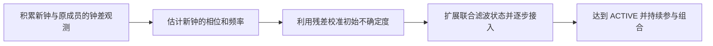
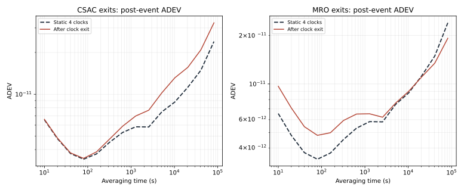
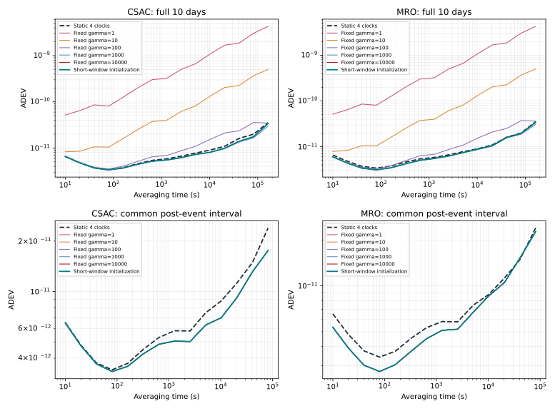

# 论文第 5.2 节：成员钟退出与新钟加入

这一节亲自运行三个实验：**四钟正常运行 → 一只钟退出 → 加入一只新钟**。加入实验再比较固定协方差和短窗稳健初始化。你可以直接修改配置、运行程序、查看输出，再用独立脚本绘图。

初始钟组为 **2 只 mRO + 2 只 CSAC，10 天，10 秒采样**。默认事件发生在开始后的第 5 天，即 **2026-01-06 00:00:00 GPST**。退出后剩 3 只，加入后有 5 只。各场景独立运行，共用同一组原始钟差。

| 场景 | 主要观察什么 |
|---|---|
| 四钟始终不变 | 留下一份对照结果 |
| CSAC / mRO 退出 | 输出是否连续；失去不同类型钟后，哪个平均时间范围变差 |
| 固定协方差加入 | 改变倍率 γ，观察接入跳变和全时段 ADEV |
| 短窗稳健初始化 | 根据短时观测估计新钟状态和不确定度，观察平滑接入及稳定度收益 |

## 1. 准备程序与数据

先按[首页](../../README.md)安装单独提供的授权运行包。以下命令均从包含 `lab.py` 的仓库根目录执行：

```powershell
python -m venv .venv
.\.venv\Scripts\python.exe -m pip install -r requirements-demo.txt
.\.venv\Scripts\python.exe tools/thesis_section52.py fetch --kind inputs --output Runs/thesis52/inputs
```

输入包约 **193 MB**，解压约 **1.38 GB**，提供四个异构钟组的 CLK、PFD 和原生配置材料；无需 STK 或轨道数据。建议为完整实验预留 8 GB，放在空间充足的磁盘上。已经下载过数据就跳过 `fetch`。

本页默认使用 `group01`。准备案例时可增加 `--group group02`、`--group group04` 或 `--group group05`，分别对应其他三个论文钟组；同一次比较应始终使用同一个组。

工具会把所用参数写入 `session.obj`：group01 的相位/频率初始标准差为 `1e-4 / 1e-6`，其他三组为 `1e-7 / 1e-9`，用于避免初始矩阵量级过大。原有钟和候选钟一起调整，过程噪声不变。你仍可直接编辑这些值；做同组对照时，应让各场景的原有钟设置保持一致。

## 2. 先运行静态四钟对照

```powershell
.\.venv\Scripts\python.exe tools/thesis_section52.py prepare-case --inputs Runs/thesis52/inputs --scenario baseline --output Runs/thesis52/cases/baseline
```

打开 `Runs/thesis52/cases/baseline/config/`，认识这四个文件：

| 文件 | 用途 |
|---|---|
| `file_table` | 指定 `Timescale.cfg`、`session.obj` 和基础表的位置 |
| `Timescale.cfg` | 时间范围、输入输出路径、动态成员开关、初始化方式与参数 |
| `session.obj` | 定义时钟、初始不确定度和过程噪声参数 |
| `membership_schedule.tsv` | 用“起始时刻、结束时刻、成员编号”定义各时段有哪些钟 |

然后直接运行程序：

```powershell
Push-Location Runs/thesis52/cases/baseline
& ..\..\..\..\engine\GstarTimescale.exe config/file_table
Pop-Location
.\.venv\Scripts\python.exe tools/plot_results.py --results Runs/thesis52/cases/baseline/results --output Runs/thesis52/cases/baseline
Start-Process .\Runs\thesis52\cases\baseline\figures\adev.png
```

这张图包含 **四只原始钟 + 组合时间尺度，五条 ADEV 曲线**。`results/IEM.txt` 最后一列是组合相位，单位秒；`SIM1.txt`～`SIM4.txt` 第 5 列为原始钟相位。

编号对应关系如下。新 mRO 使用 `0106`，不要把它改成 CSAC 使用的 `0105`。

| 编号 | 时钟 | 角色 |
|---|---|---|
| `0101`、`0102` | mRO | 初始成员 |
| `0103`、`0104` | CSAC | 初始成员 |
| `0105` | 新 CSAC | CSAC 加入场景的候选钟 |
| `0106` | 新 mRO | mRO 加入场景的候选钟 |

## 3. 运行两种退出场景

分别让 `0104`（CSAC）和 `0102`（mRO）退出：

```powershell
.\.venv\Scripts\python.exe tools/thesis_section52.py prepare-case --inputs Runs/thesis52/inputs --scenario csac_exit --output Runs/thesis52/cases/csac_exit
.\.venv\Scripts\python.exe tools/thesis_section52.py prepare-case --inputs Runs/thesis52/inputs --scenario mro_exit --output Runs/thesis52/cases/mro_exit
foreach ($caseName in @('csac_exit', 'mro_exit')) {
    Push-Location "Runs/thesis52/cases/$caseName"
    & ..\..\..\..\engine\GstarTimescale.exe config/file_table
    if ($LASTEXITCODE -ne 0) { Pop-Location; throw "运行失败：$caseName" }
    Pop-Location
}
```

例如 CSAC 退出的日程是下面两行。文件里的三列以 **Tab 制表符**分隔，第二段少了 `0104`：

```text
start_gpst             end_gpst               active_prns
2026-01-01T00:00:00    2026-01-06T00:00:00     0101,0102,0103,0104
2026-01-06T00:00:00    2026-01-11T00:00:00     0101,0102,0103
```

日程区间为左闭右开：到了第二段的起始时刻，新成员列表开始生效。

## 4. 运行新钟加入：先比较三种初始化

第一次分别运行 **γ=1、γ=10000、短窗稳健初始化**，就能看出参数与接入效果的关系。下面循环仅负责准备配置，每个目录都可以单独打开和修改：

```powershell
foreach ($kind in @('csac', 'mro')) {
    foreach ($gamma in @(1, 10000)) {
        .\.venv\Scripts\python.exe tools/thesis_section52.py prepare-case --inputs Runs/thesis52/inputs --scenario "${kind}_join" --admission fixed --gamma $gamma --output "Runs/thesis52/cases/${kind}_fixed${gamma}"
    }
    .\.venv\Scripts\python.exe tools/thesis_section52.py prepare-case --inputs Runs/thesis52/inputs --scenario "${kind}_join" --admission robust --window 120 --output "Runs/thesis52/cases/${kind}_robust"
}
```

打开其中一个 `Timescale.cfg`，就能看到实际交给程序的设置。

固定协方差方式：

```text
 Centralized admission covariance initialization = legacy
 Centralized admission covariance inflation = on
 Centralized admission covariance inflation scale = 10000
```

γ 放大的是**新加入钟的初始方差**。`session.obj` 中 `Phase`、`Frequency` 逗号前填写标准差：例如相位初始标准差 `1e-4` 对应方差 `1e-8`，再乘 γ。这里修改的是接入初始不确定度，与第 4.4 节优化过程噪声 q₁/q₂ 的实验不同。

短窗方式：

```text
 Centralized admission covariance initialization = calibrated_bounded_influence
 Centralized admission observation window = 120
 Centralized admission covariance inflation = off
```

程序使用短时观测估计新钟的状态和协方差，不需要预选 γ。`120` 的单位是秒，表示观测统计窗口；**实际接入时刻还取决于统计条件和接入过程**，以结果中的成员事件记录为准。

第 5.2.1 节短窗方式的计算顺序如下。新钟正式参与前，时间尺度仍由原四钟维持：



开始运行这六个案例：

```powershell
foreach ($caseName in @('csac_fixed1', 'csac_fixed10000', 'csac_robust', 'mro_fixed1', 'mro_fixed10000', 'mro_robust')) {
    Push-Location "Runs/thesis52/cases/$caseName"
    & ..\..\..\..\engine\GstarTimescale.exe config/file_table
    if ($LASTEXITCODE -ne 0) { Pop-Location; throw "运行失败：$caseName" }
    Pop-Location
}
```

一次 10 天运行在验证机器上约需 2～3 分钟。连同基线和退出实验，首次主流程共 9 次运行。

## 5. 单独绘图，比较结果

```powershell
.\.venv\Scripts\python.exe tools/thesis_section52.py analyze --cases Runs/thesis52/cases --output Runs/thesis52/comparison
Start-Process .\Runs\thesis52\comparison\report.html
```

报告直接读取这些运行目录的 `IEM.txt`、成员事件和接入诊断；你改了 γ 后，图例会读取实际配置中的值。

| 输出文件（位于 `comparison/`） | 怎么看 |
|---|---|
| `figures/member_clocks_adev.png` | 六只可用钟及静态组合的 ADEV，认识两种钟的优势区间 |
| `figures/fig5_2_exit_response.png` | 退出前 6 小时至退出后 24 小时的相位、频率响应 |
| `figures/fig5_3_exit_adev.png` | 只用退出后的数据，观察失去一只钟的影响 |
| `figures/fig5_4_csac_join_response.png` | 新 CSAC 加入：全时段响应与较小扰动的局部比较 |
| `figures/fig5_5_mro_join_response.png` | 新 mRO 加入的同类比较 |
| `figures/fig5_6_join_adev.png` | 上排：完整 10 天；下排：各方法共同的事件后区间 |
| `tables/adev_exact.tsv` | 在指定 τ 直接计算的 ADEV、误差估计和有效项数 |
| `tables/improvement.tsv` | 相对静态四钟的改善率；正值为改善，负值为变差 |
| `tables/event_metrics.tsv` | 实际接入时刻、相位跳变、频率跳变等 |

每张图还会输出 SVG 和 PDF。频率由组合相位的一阶差分得到；相位跳变在**实际进入联合滤波的时刻**计算。完整 10 天的 ADEV 包含接入瞬态，不能只看加入后平稳时段来判断初始化是否做好。

数值表中的 `full` 是完整运行时段，`post_event` 从日程中的事件时刻开始，`post_active` 则等到两类新钟都完全接入后再取共同区间。正式数值在所列 τ 直接计算，包含图中约 10⁴ 秒处的 **10240 秒**，不从曲线插值。

应该观察到的主要现象是：CSAC 退出主要损失中长期稳定度，mRO 退出主要损失短期稳定度；γ 太小时，加入瞬间的频率扰动会明显拉高全时段 ADEV；短窗初始化能够平滑接入，同时保留新成员钟带来的稳定度收益。

下面是按本页配置重新运行得到的结果。ADEV 越低越好，四项比较都使用事件后的共同时间段：

| 实验 | 平均时间 τ | 静态四钟 ADEV | 变化后 ADEV | 观察 |
|---|---:|---:|---:|---|
| CSAC 退出 | 10240 s | 8.79×10⁻¹² | 1.31×10⁻¹¹ | 长时稳定度变差 |
| mRO 退出 | 10 s | 6.55×10⁻¹² | 9.67×10⁻¹² | 短时稳定度变差 |
| 新 CSAC 短窗接入 | 10240 s | 8.79×10⁻¹² | 6.98×10⁻¹² | 改善约 **20.7%** |
| 新 mRO 短窗接入 | 10 s | 6.55×10⁻¹² | 5.35×10⁻¹² | 改善约 **18.3%** |



下图包含五档 γ 和短窗方式。先看上排：γ 小时，接入扰动拉高完整 10 天的 ADEV。再看下排：新钟平稳加入后，不同初始化曲线几乎重合，体现新钟本身的收益。



这也说明为什么不能只展示一张“加入后”的 ADEV：它会掩盖加入瞬间的扰动。

## 可选：补齐 γ=10、100、1000 的曲线

```powershell
foreach ($kind in @('csac', 'mro')) {
    foreach ($gamma in @(10, 100, 1000)) {
        $caseName = "${kind}_fixed${gamma}"
        .\.venv\Scripts\python.exe tools/thesis_section52.py prepare-case --inputs Runs/thesis52/inputs --scenario "${kind}_join" --admission fixed --gamma $gamma --output "Runs/thesis52/cases/$caseName"
        Push-Location "Runs/thesis52/cases/$caseName"
        & ..\..\..\..\engine\GstarTimescale.exe config/file_table
        if ($LASTEXITCODE -ne 0) { Pop-Location; throw "运行失败：$caseName" }
        Pop-Location
    }
}
.\.venv\Scripts\python.exe tools/thesis_section52.py analyze --cases Runs/thesis52/cases --output Runs/thesis52/comparison_full
```

这样就有论文中五档固定倍率和短窗方式的完整对照。不同 γ 的后期 ADEV 可能几乎重合，但接入跳变和全时段 ADEV 仍有很大差异。

## 可选：自己修改事件时间和观测窗口

准备案例时加 `--event-day 4` 可以将事件改到开始后第 4 天，`--window 300` 可以使用 5 分钟统计窗口。也可以直接编辑 `Timescale.cfg` 和 `membership_schedule.tsv`。

**改了成员日程后，要同步 PFD 链路：**当前程序要求每个时段的观测端点与成员列表一致。输入包保留了完整 10 天的候选观测，下面的命令按新日程筛选，观测数值不会改变：

```powershell
.\.venv\Scripts\python.exe tools/thesis_section52.py sync-pfd --case Runs/thesis52/cases/csac_robust
```

准备案例时已经自动执行这一步。再次同步会保留旧的 PFD 目录，并更新 `Timescale.cfg` 中的输入路径。重新运行时请使用新的实验目录或新的 `Project directory`，保留旧结果作对照。若缩短运行时间，日程也应完整覆盖新的起止范围；数据覆盖 2026-01-01 至 2026-01-11 之前。

本节动态成员功能使用 **集中式、PFD、二状态、Greenhall、无谐波**。项目其他实验仍可选 `NONE / SUMZERO / BROWN / GREENHALL / KPW`；这组动态实验按其支持条件固定 Greenhall。

接入日志中，`PENDING_INFORMATION` 表示观测评估，`ADMITTING` 表示正在接入，`ACTIVE` 表示完全接入。对应文件为 `results/centralized_calibrated_bounded_influence.tsv`；真正扩展状态的时刻记录在 `results/centralized_membership_events.tsv`。初始阶段部分诊断量尚未定义，检查成功与否应结合状态、完整输出和程序日志。

## 可选：不用运行包，先重画保存的论文实验数据

约 12.4 MB 的分析包包含 group01 的原始相位序列和全部 15 个对照结果。下面仍然会重新计算 ADEV 和接入扰动，再生成图表：

```powershell
.\.venv\Scripts\python.exe tools/thesis_section52.py fetch --kind analysis --output Runs/thesis52/archive
.\.venv\Scripts\python.exe tools/thesis_section52.py analyze-archive --data Runs/thesis52/archive --output Runs/thesis52/archive_comparison
Start-Process .\Runs\thesis52\archive_comparison\report.html
```

这条路径对应图 5.2～5.6 的主要比较。图 5.1 是方法流程图；表 5.1 的四组平均值与本页单组事件统计应区分。

## 可选：计算四组平均接入扰动

先完成本页 group01 的主流程，再分别对 group02、group04、group05 重复第 2～5 步：

1. 每条 `prepare-case` 命令增加对应的 `--group group02`（另两组替换组号）。
2. 案例和报告路径中的 `Runs/thesis52/` 换成 `Runs/thesis52-group02/`；`--inputs Runs/thesis52/inputs` 保持不变，四组共用同一数据包。
3. `analyze` 命令也增加 `--group group02`。这样每组有自己的静态基线和比较报告。

四组报告都生成后，汇总 γ=1、γ=10000 和短窗方式：

```powershell
.\.venv\Scripts\python.exe tools/thesis_section52.py summarize-events --reports Runs/thesis52/comparison Runs/thesis52-group02/comparison Runs/thesis52-group04/comparison Runs/thesis52-group05/comparison --output Runs/thesis52/four_groups
Start-Process .\Runs\thesis52\four_groups\report.html
```

`four_groups/table5_1_event_summary.tsv` 保存四组绝对跳变的平均值，`events_by_group.tsv` 保存每组明细。若也希望汇总 γ=10、100、1000，需要在**每一组**都完成对应案例并重画报告，再汇总。脚本不会把缺少部分组的方法混入平均值。

已按这些默认配置完成四组共 42 次完整运行，统计趋势与单组曲线一致：提高固定 γ 可以降低接入跳变，短窗方式进一步抑制瞬态。具体数值见[验证记录](validation.md)。

[数据下载页](https://github.com/Xsleet/GstarTimescale-Lab/releases/tag/thesis-section52-data-v1) · [验证范围与计算约定](validation.md) · [配置说明](../../docs/configuration.md) · [结果列说明](../../docs/results.md)
